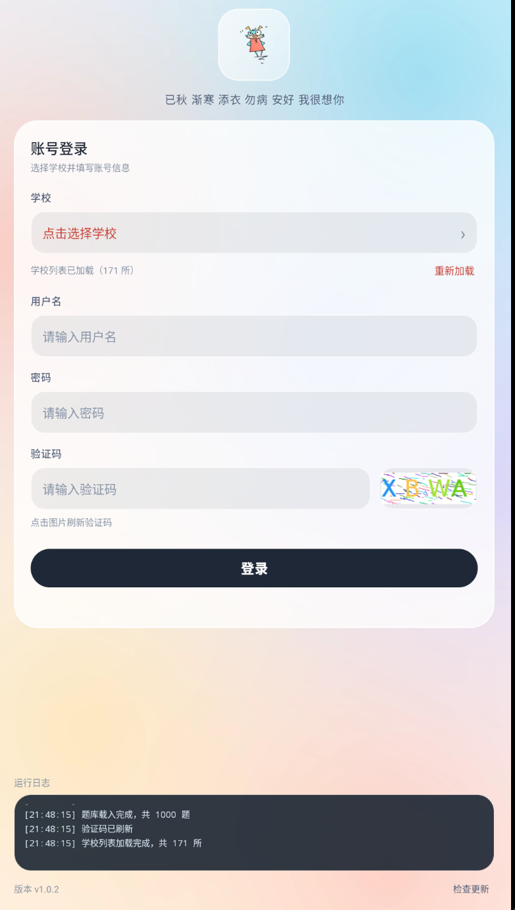
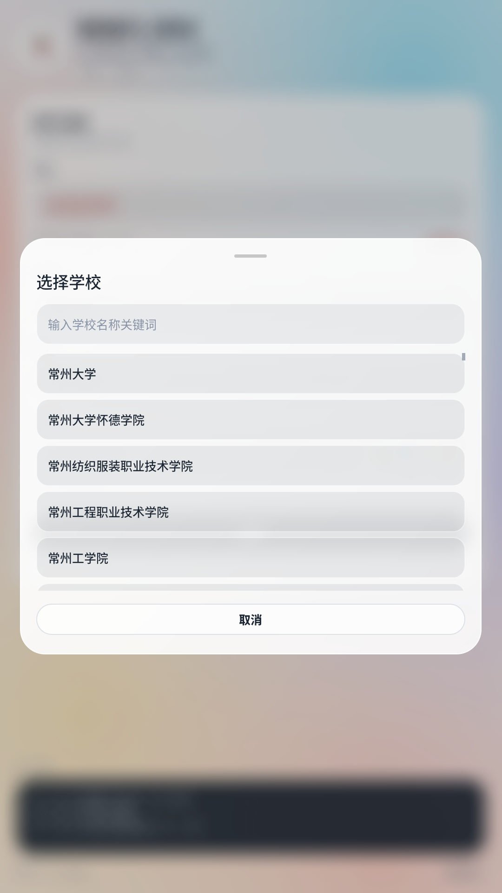
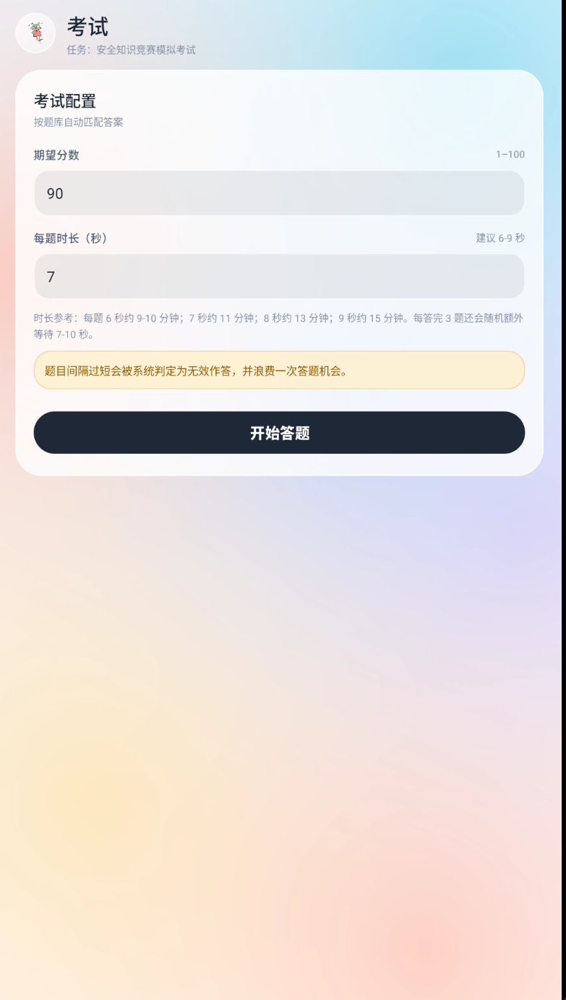
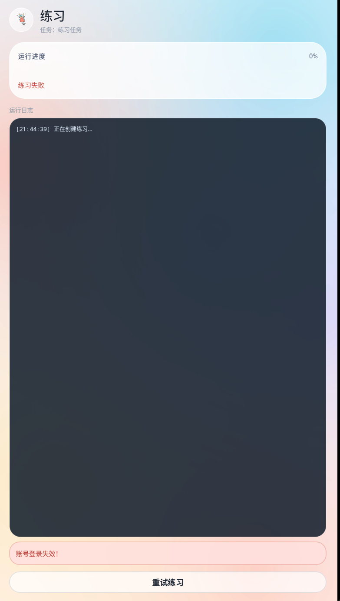
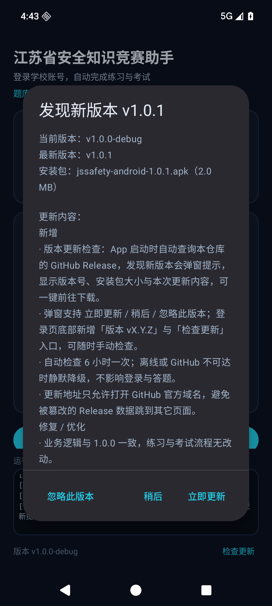

# 喵喵的小脚本 · 江苏省大学生安全知识竞赛 Android 版

把"江苏省大学生安全知识竞赛"的**练习刷题**与**考试答题**搬到手机上：选学校 → 登录 → 选任务 → 自动答题/自动收录题库。

> 📦 **本仓库只发布编译产物（APK），不包含任何源代码，也不公开源代码。**
> Release APK 已启用 R8 混淆与资源压缩，安装包约 2.4 MB。
> **1.0.2 视觉改版（2026-10-21）**：浅色液态玻璃界面、手绘猫猫图标；首页只保留图标与一句问候，学校选择弹窗在支持的设备上带背景模糊。
> **1.0.1 起支持版本更新检查**：App 启动时查询本仓库的最新 Release，发现新版本会弹窗提示。

<p align="center">
  
  
  
</p>

## 下载安装

| 文件 | 大小 | 适用 |
|---|---|---|
| [`jssafety-android-1.0.2.apk`](jssafety-android-1.0.2.apk) | 2,512,503 B | 日常安装（最新） |
| [Release v1.0.2](https://github.com/miaoliwen/jiangsu-safety-android/releases/tag/v1.0.2) | 同包 | 正式发布页（含校验值） |
| [`jssafety-android-1.0.1.apk`](jssafety-android-1.0.1.apk) | 2,106,635 B | 旧版存档 |

- 系统要求：**Android 7.0（API 24）及以上**
- 包名：`com.xiaohan.jssafety`
- 版本：`1.0.2`（versionCode 5）
- 签名证书 SHA-256：`c322590104abd7923a394a1d6ddd8883f373697707ff2eab7efff10d0b5df0f5`
- APK SHA-256：`1c89b7999190aa4344522ebf26ff5913abb609aa709eaaed09c4a55b035223bd`（同 [`SHA256SUMS.txt`](SHA256SUMS.txt)）

安装：

```bat
adb install -r jssafety-android-1.0.2.apk
```

或把 APK 传到手机点击安装（需允许"安装未知来源应用"）。

## 版本更新

- App 启动时在后台查询本仓库 GitHub Release 的**最新正式版**（`releases/latest`），发现比当前安装包更新的版本就弹窗提示；自动检查 6 小时最多一次。
- 弹窗显示当前版本、最新版本、安装包大小与本次更新说明（即 Release 描述），提供 **立即更新 / 稍后 / 忽略此版本** 三个选项。
- 登录页底部显示「版本 vX.Y.Z」与「检查更新」，可随时手动检查；检查失败（离线 / GitHub 不可达）只写日志，不影响登录答题。
- **发布新版本**：在本仓库创建 Release（tag 形如 `v1.0.2`）并附上 APK，旧版本 App 下次启动就会收到提示。`v1.0.2` Release 已发布，1.0.1 及更早版本下次启动即可收到更新提示。

## 1.0.2 更新内容

- 全新浅色液态玻璃界面：柔和极光背景、半透明玻璃卡片、磨砂输入框与胶囊按钮。
- 应用图标更换为手绘猫猫；首页仅保留猫猫图标与「已秋 渐寒 添衣 勿病 安好 我很想你」。
- 学校选择弹窗支持背景模糊（支持的设备）。
- 考试模式保留「每答完 3 题随机额外等待 7–10 秒」的节流逻辑。
- 版本号 `1.0.2`（versionCode 5）。

## 功能

- **学校检索**：内置全国 171 所参赛高校列表，支持关键词过滤，唯一命中自动选中
- **账号登录**：学号/用户名 + 密码（MD5 大写）+ 图形验证码；验证码图片点击刷新，验证码错误自动换图重试
- **任务列表**：自动识别"练习 / 考试"并打徽章；登录失效（顶号 401）自动回到登录页
- **练习模式**：自动创建练习、逐页拉取正确答案并收录进本地题库、自动提交，过程实时日志 + 进度 + 结果卡片
- **考试模式**：自定义期望分数与每题时长；逐题作答并显示"题库命中 / 题库缺失 / 故意错答"；交卷后显示得分、通过状态、用时与缺失题路径
- **内置题库**：1000 题随 APK 打包，首启复制到应用私有目录；考试中缺失的题会记录到 `files/missing_questions.json`，可导出补充
- **版本更新检查**：启动自动查询 GitHub Release，新版本弹窗提示（立即更新 / 稍后 / 忽略此版本），登录页底部可手动检查
- **浅色液态玻璃界面**：纯原生 Android（非 WebView），柔和极光背景、半透明玻璃卡片与磨砂输入框，学校选择弹窗支持背景模糊

## 使用步骤

1. 打开 App，点"选择学校"，输入学校关键词（如"南京"）后点选；唯一命中会自动选中。
2. 填学号/用户名与密码，输入验证码图片中的字符（点图片可刷新）。
3. 登录后进入任务列表：
   - 任务名含"练习 / 刷题 / 闯关" → 练习模式；
   - 含"考试 / 考核 / 模拟" → 考试模式；
   - 无法判断时按旧规则把前两项当作练习。
4. **练习**：进入即自动跑完 10 页并提交，结束后显示"新收录 / 已有 / 无答案"和题库总数。
5. **考试**：填写期望分数（默认 90）与每题时长（默认 7 秒，**建议 6–9 秒**，过短会被平台判定为无效作答并浪费一次机会），点"开始答题"；结束后查看得分与缺失题记录。
6. 运行期间**不要**在其它设备或浏览器登录同一账号，否则会顶号导致 401、浪费答题机会。
7. 有新版本发布后，旧版本 App 启动会自动弹窗；也可以在登录页底部点「检查更新」立即检查。

## 截图

| 首页（猫猫图标 + 问候） | 选择学校 |
|---|---|
|  |  |

| 考试配置 | 练习运行 |
|---|---|
|  |  |

| 版本更新弹窗（1.0.1 历史截图，旧版深色界面） |
|---|
|  |

## 题库说明

- 内置 1000 题，安装后位于 `/data/data/com.xiaohan.jssafety/databases/question_bank.db`。
- 练习模式会把平台返回的正确答案自动收录进题库；考试模式优先用题库答案，超出期望分数的题会故意答错。
- 题库缺失的题会写入 `/data/data/com.xiaohan.jssafety/files/missing_questions.json`，建议先跑一遍练习补齐题库再考试。
- 非 root 设备无法直接读取私有目录（本 App 为 release 包，不可 `run-as`），需要导题库请自行用可信工具处理。

## 常见问题

- **提示"账号登录失效"**：账号在别处登录把 token 顶掉了；重新登录即可。考试中被顶号会浪费一次答题机会。
- **验证码看不清**：点验证码图片刷新；输错会自动换一张。
- **被判无效作答**：每题时长太短，调到 6–9 秒。
- **网络错误**：切换校园网/热点后重试；接口域名 `mars.mycourse.cn` 需可达。
- **安装失败**：先卸载同名旧版本；不同签名无法覆盖安装。

## 隐私与使用声明

- App 只在本地运行；登录凭据仅用于向官方平台（`mars.mycourse.cn`）发起登录与答题请求，不发送给任何第三方，也不做任何上传。
- 版本更新检查会向 GitHub 发起一次匿名请求（仅读取 Release 元数据，不携带账号、密码或设备标识）；无需更新时可忽略。
- 题库、缺失题记录都保存在手机本地，不联网同步。
- 本工具仅供**个人学习交流与自动化技术研究**使用；使用产生的一切后果（包括平台判定、账号风险）由使用者自行承担。

## 许可与致谢

- 本项目是 [jiangsu-safety-competition](https://github.com/Scwizard/jiangsu-safety-competition)（作者：南晓 Scwizard）的 Android 移植版本，遵循 [Apache License 2.0](LICENSE) 发布**编译产物**。
- 依据 Apache 2.0 第 4 条，以二进制形式分发时保留许可证与声明；源代码不在本仓库、不对外提供。

---

**本仓库不包含源码**：仓库内仅有 APK、说明文档、截图与许可证。若需源码或有功能建议，请通过 Issue 联系作者。
